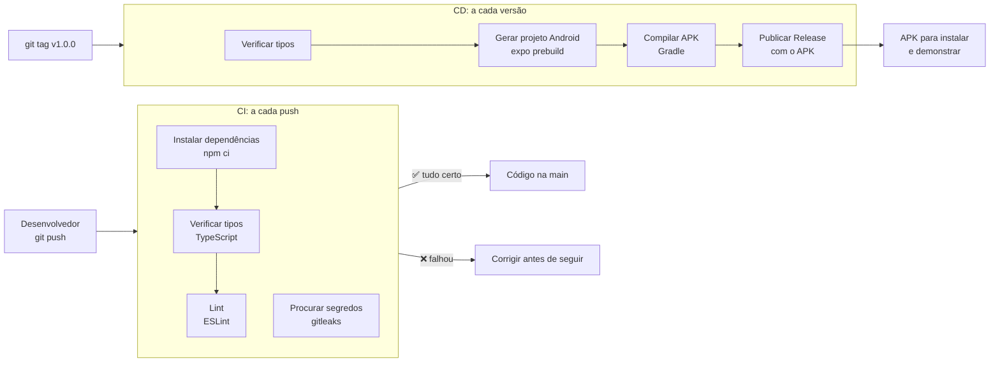

# CI/CD do Conf-IA

O projeto usa **Integração Contínua (CI)** para verificar todo código enviado ao repositório e **Entrega Contínua (CD)** para gerar o aplicativo Android instalável a partir de uma versão marcada.

| | Onde roda | Quando roda | Arquivo |
|---|---|---|---|
| **CI** | GitHub Actions e GitLab CI | Todo push na `main` e todo Pull/Merge Request | [`.github/workflows/ci.yml`](../.github/workflows/ci.yml), [`.gitlab-ci.yml`](../.gitlab-ci.yml) |
| **CD** | GitHub Actions | Toda tag de versão (`v1.0.0`, `v1.1.0`...) ou manualmente | [`.github/workflows/release-android.yml`](../.github/workflows/release-android.yml) |

---

## Visão geral



---

## CI: o que é verificado e por quê

| Etapa | Ferramenta | O que pega |
|---|---|---|
| Instalar dependências | `npm ci` | Usa **exatamente** as versões do `package-lock.json`. Se o lock estiver desatualizado, falha: garante que o código funciona igual em qualquer máquina |
| Verificar tipos | TypeScript (`tsc --noEmit`) | Erros de tipo: propriedade que não existe, prop faltando num componente, valor incompatível. Exemplo real do projeto: um componente recebendo `myVote` sem ele ter sido passado |
| Lint | ESLint (`expo lint`) | Erros de padrão do React, como hooks chamados fora de componentes (corrigido em `toastConfig.tsx` ao montar este pipeline) |
| Procurar segredos | gitleaks | Senhas e chaves commitadas por engano, em **todo o histórico** do git (um segredo apagado continua nos commits antigos) |

**Achados de segredo revisados:** a única ocorrência no histórico é a chave *publishable* do Supabase, que é pública por natureza (vai dentro do aplicativo; quem protege os dados é a RLS do banco). Ela foi registrada como revisada em [`.gitleaksignore`](../.gitleaksignore), com a justificativa.

---

## CD: como uma versão vira um APK

1. Uma tag de versão é enviada: `git tag v1.0.0 && git push origin v1.0.0`
2. O pipeline confere se os *secrets* necessários existem e falha com uma mensagem clara se faltar algum
3. Verifica os tipos de novo: não gera APK de código que não compila
4. `expo prebuild` gera o projeto Android nativo a partir do `app.json`/`app.config.js` (a pasta `android/` não fica no repositório)
5. O Gradle compila o APK
6. O APK é publicado numa **Release** do GitHub, com as notas geradas a partir dos commits

O build roda no próprio servidor do GitHub, **sem depender de conta externa** (Expo/EAS). O APK é assinado com a chave de debug: serve para instalar e demonstrar, mas não para publicar na Play Store, que exige uma chave de assinatura própria guardada como *secret*.

---

## Decisões de projeto

- **As chaves do app não ficam no repositório.** O `.env` está no `.gitignore`. No CD, os valores vêm dos *secrets* do GitHub e são embutidos no APK no momento do build.
- **As migrations do banco não são aplicadas automaticamente.** O banco do Supabase é compartilhado e é o mesmo da demonstração. Uma migration aplicada sozinha, sem revisão, pode quebrar o app de todos. Por isso a aplicação de migrations continua sendo feita por uma pessoa, com o script [`scripts/supabase-remote.sh`](../scripts/supabase-remote.sh) e um `--dry-run` antes. É uma escolha consciente de manter uma pessoa no processo nessa etapa.
- **A mesma verificação no GitHub e no GitLab.** O GitLab é o repositório do curso; o GitHub executa o CD.
- **Concorrência:** dois pushes seguidos cancelam a verificação do primeiro, economizando minutos de CI.

---

## Configuração necessária (uma vez)

### Secrets do GitHub (para o CD)

Em **Settings → Secrets and variables → Actions → New repository secret**:

| Secret | Valor | Obrigatório |
|---|---|---|
| `EXPO_PUBLIC_SUPABASE_URL` | URL do projeto Supabase (mesma do `.env`) | Sim |
| `EXPO_PUBLIC_SUPABASE_ANON_KEY` | Chave anon/publishable (mesma do `.env`) | Sim |
| `GOOGLE_MAPS_API_KEY` | Chave do Google Maps SDK for Android (ver abaixo) | Sim |
| `EXPO_PUBLIC_OPENWEATHER_API_KEY` | Chave da OpenWeather (mesma do `.env`) | Não (sem ela, o clima aparece como "Estimado") |

### Chave do Google Maps

O `react-native-maps` no Android precisa de uma chave do Google. No Expo Go não precisa (ele usa a da Expo), mas **no APK, sem a chave, a tela do Mapa fecha o aplicativo**.

1. No [Google Cloud Console](https://console.cloud.google.com/), crie um projeto
2. Ative a API **Maps SDK for Android**
3. Em **Credenciais**, crie uma **chave de API**
4. Recomendado: restrinja a chave ao app Android `com.confia.app`
5. Cadastre a chave no secret `GOOGLE_MAPS_API_KEY`

A chave é lida em [`app.config.js`](../app.config.js) a partir da variável de ambiente, então ela não fica no repositório.

---

## Como usar no dia a dia

```bash
# Ver o resultado do CI: aba "Actions" do GitHub ou "Build → Pipelines" do GitLab.
# O ✅/❌ também aparece ao lado de cada commit.

# Rodar localmente as mesmas verificações do CI, antes de enviar:
npm run typecheck
npm run lint

# Gerar uma versão (dispara o CD):
git tag v1.0.0
git push origin v1.0.0
# Depois de ~15 a 25 min, o APK aparece em "Releases" no GitHub.
```

---

## Próximos passos

- **Testes automatizados:** incluir uma etapa de testes unitários (Jest) no CI, começando pelas funções puras (`haversineKm`, `boundingBox`, `hasVoteChanged`)
- **Proteção da `main`:** exigir o CI verde antes de aceitar um Pull Request (GitHub: **Settings → Branches**)
- **Assinatura de produção:** chave de assinatura própria como *secret*, para publicar na Play Store
- **Reduzir os avisos do lint** (hoje 47, nenhum erro) e então tratar avisos como erro no CI
